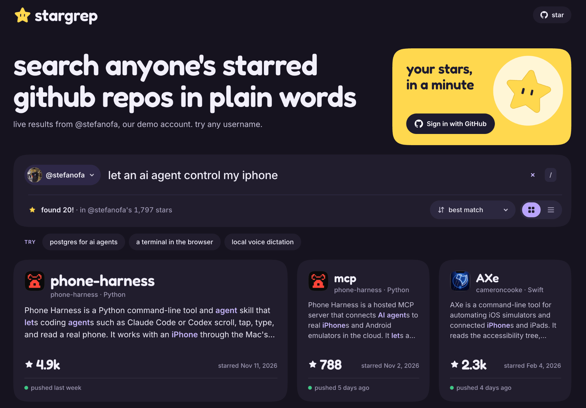

# Stargrep

Search the public repos any GitHub account starred, in plain language.

[](https://stargrep.com)

## What it does

Open [stargrep.com](https://stargrep.com), enter any GitHub login, and describe what you are looking for, such as "rust library for terminal dashboards". Stargrep searches the repos that account starred and ranks them by how well they match. Keyword matches show as you type, and matches by meaning follow when you pause. Searching needs no account. Signing in with GitHub imports your own stars with your token.

Coding agents can search too. One API serves the web app, REST under `/api`, and MCP under `/mcp`, and [`/openapi.json`](https://stargrep.com/openapi.json) describes the REST procedures. To add Stargrep to Claude Code:

```sh
claude mcp add --transport http stargrep https://stargrep.com/mcp
```

The [API section of the setup guide](docs/setup.md#api) has REST examples.

## How it works

- Stargrep reads an account's stars from the GitHub API the first time someone opens it, and again when its owner opens their own page.
- Each repo is read once, however many accounts starred it. A model reads its README and writes a short summary and typed facts, such as its language and what it is about. The summary then gets an embedding.
- A model usually plans each query first. It reads filters from it, such as a language or a starred date, and writes a description of a matching repo.
- The search is one Postgres query. It runs full-text search on the words typed and a pgvector similarity search on the embedded description, and merges the two lists by reciprocal rank fusion.
- It runs on Cloudflare Workers, with Queues for imports and summaries, and Neon Postgres behind Hyperdrive. The app is TanStack Start, and the domain logic is Effect.

[Architecture](docs/architecture.md) explains each part, and [Repo knowledge](docs/knowledge.md) explains the facts.

## Run it locally

You need Bun 1.4.3 and Docker. [Setup](docs/setup.md) has every step, including deployed stages.

```sh
bun install --frozen-lockfile
bun scripts/sync-repos.ts
docker compose up --detach --wait
bun run --cwd infra dev
```

The last command runs the whole stage on your machine with no cloud account, against the Postgres container, and the web app answers on `http://localhost:1340`. Without a GitHub token and an AI Gateway key, the stage cannot import stars or search by meaning.

To run the checks and the tests, with the container up:

```sh
bun run check
bun test --parallel
```

## Docs

- [Product spec](docs/product.md)
- [Architecture](docs/architecture.md)
- [Effect conventions](docs/effect.md)
- [Design system](design/system.md)
- [Third-party notices](THIRD_PARTY_NOTICES.md)

## License

Stargrep is licensed under the [GNU Affero General Public License v3.0 only](LICENSE). Third-party material in this repository keeps its own license, as [THIRD_PARTY_NOTICES.md](THIRD_PARTY_NOTICES.md) lists.
